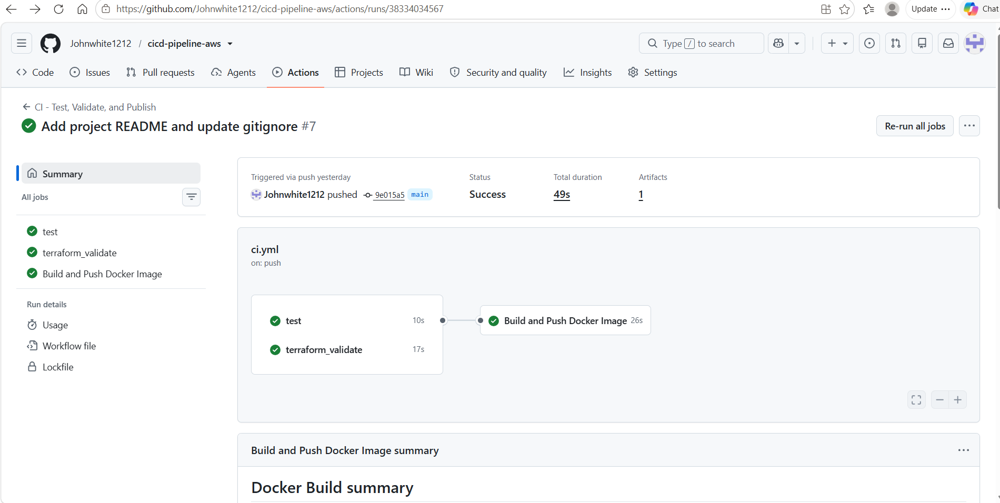
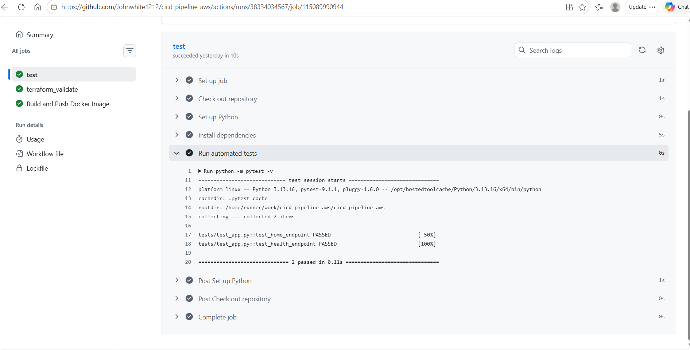

# AWS CI/CD Pipeline with GitHub Actions, Docker, Terraform, and Amazon ECR

## Project Overview

This project demonstrates an automated CI pipeline for a Python Flask application. GitHub Actions runs automated tests, validates Terraform configuration, builds a Docker image, and publishes the image to Amazon Elastic Container Registry (ECR).

The pipeline uses GitHub's OpenID Connect (OIDC) integration to authenticate to AWS without storing long-lived AWS access keys in GitHub repository secrets.

## Architecture

```text
Developer pushes code to GitHub
              |
              v
       GitHub Actions
              |
      +-------+--------+
      |                |
      v                v
 Python tests     Terraform validation
      |                |
      +-------+--------+
              |
              v
     Build Docker image
              |
              v
   GitHub OIDC authentication
              |
              v
       Amazon ECR
              |
              v
   Publish container image
   - latest tag
   - commit SHA tag
```

## Technologies Used

- **Python 3.13** — application runtime
- **Flask** — web application framework
- **pytest** — automated testing
- **Docker** — application containerization
- **GitHub Actions** — CI automation
- **Terraform** — infrastructure as code and configuration validation
- **AWS IAM and OIDC** — short-lived authentication for GitHub Actions
- **Amazon ECR** — private container image registry
- **AWS CLI** — AWS resource inspection and verification
- **Git and GitHub** — source control and collaboration

## Repository Structure

```text
cicd-pipeline-aws/
├── .github/
│   └── workflows/
│       └── ci.yml
├── app/
│   └── main.py
├── infra/
│   ├── main.tf
│   ├── github-actions-trust-policy.json
│   └── github-actions-ecr-policy.json
├── tests/
│   └── test_app.py
├── .gitignore
├── Dockerfile
├── requirements.txt
└── README.md
```

The `infra/` directory contains Terraform configuration for the ECR repository and JSON policy files used to configure GitHub Actions access to AWS. Other Terraform-generated files may also be present locally.

## CI Pipeline

The workflow runs on pushes to the `main` branch and pull requests targeting `main`.

### 1. Automated tests

- Sets up Python 3.13.
- Installs application dependencies and pytest.
- Executes the test suite with `python -m pytest -v`.

### 2. Terraform validation

- Sets up Terraform.
- Checks Terraform formatting.
- Initializes Terraform without configuring a remote backend.
- Validates the infrastructure configuration.

### 3. Docker image publishing

After the test and Terraform validation jobs succeed on a push to `main`, the pipeline:

- Builds the Docker image.
- Authenticates to AWS using GitHub Actions OIDC.
- Logs in to Amazon ECR.
- Pushes the image to the ECR repository.
- Publishes a `latest` tag and a commit-specific tag.

The workflow also uses concurrency controls to reduce overlapping runs in the same group.

## AWS Configuration

- **Region:** `us-east-1`
- **ECR repository:** `cicd-pipeline-aws`
- **Image URI:** `823963318359.dkr.ecr.us-east-1.amazonaws.com/cicd-pipeline-aws`
- **Authentication:** GitHub Actions OIDC with an IAM role

The ECR repository is configured for mutable tags, image scanning on push, and AES-256 encryption.

## Security Considerations

- Uses OIDC instead of storing long-lived AWS access keys in GitHub.
- Restricts the workflow's IAM trust relationship to the intended GitHub repository and branch identity.
- Scopes ECR image operations to the project repository where applicable.
- Excludes Terraform state files and variable files through `.gitignore`.
- Keeps AWS credentials and other secrets out of source control.

The IAM trust policy and permissions should be reviewed periodically as the project evolves.

## Verification

The pipeline has successfully completed the following checks during development:

- Python automated tests passed in GitHub Actions.
- Terraform formatting and validation passed.
- Docker image build and Amazon ECR publishing succeeded.
- The `latest` tag and a commit-specific tag were verified against the same ECR image digest.
- All three GitHub Actions jobs passed after the concurrency and ECR policy updates.

## Scope and Future Improvements

This project demonstrates **continuous integration and container image publishing**. It does not currently deploy the application to a running production environment.

Potential next steps include:

- Deploying the container to Amazon ECS with AWS Fargate.
- Adding deployment approval gates and rollback procedures.
- Adding vulnerability scanning and image retention policies.
- Adding a pipeline status badge and screenshots of successful runs.
- Adding monitoring and operational alerts for a deployed application.

## Learning Outcomes

This project provided hands-on practice with Python testing, Docker containerization, Terraform validation, GitHub Actions workflows, AWS IAM, OIDC federation, Amazon ECR, and troubleshooting cloud automation.

---

**Author:** John White  
**GitHub Repository:** [cicd-pipeline-aws](https://github.com/Johnwhite1212/cicd-pipeline-aws)


## Screenshots

### GitHub Actions Workflow

The CI/CD pipeline successfully runs automated tests, validates Terraform configuration, and builds and publishes the Docker image to Amazon ECR.



### Automated Python Tests

The Python application tests pass successfully.

